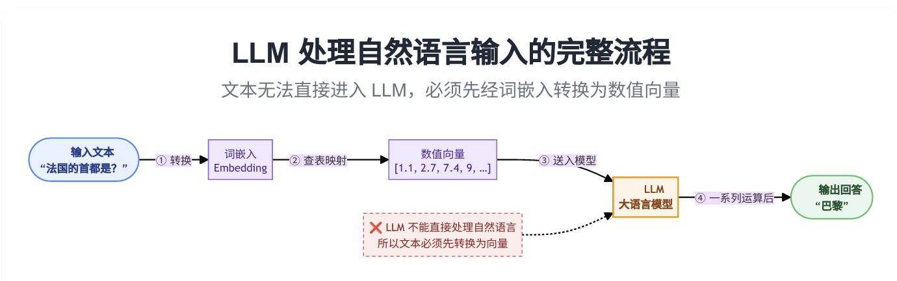
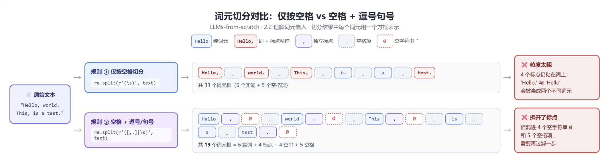
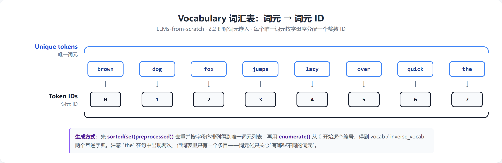

## Understanding word embeddings-初识词嵌入
###  
  这里不先讲词嵌入的机制和原理，先粗浅的了解一下词嵌入在LLM中的作用。
  由于LLM不能直接利用原始的自然语言，所以需要词嵌入工程来把原始自然语言转化为具有语义的向量。
  词嵌入工程可以先理解为一个黑盒(也就是暂时不去纠结它的机制)，输入的是自然语言文本，输出的是一组高维向量。
  

接下来将具体讲解如何实现：文本->向量的转变

## Tokenizing text-文本词元化
###
  首先辨析一下关键概念：词元。词元可以理解为最小的语义单位，如一个单词，一个标点，一个组合之类的。
  而我们的任务是把连续的自然语段切分成离散的词元。
 

  我们可以进一步加强正则限制，进一步细化词元分割，从而达到想要的效果。
  接下来就是实现：token->token ID

## Converting tokens into token IDs-词元ID替换
  其实这个很简单，先是预备一个词汇表，按照一定的规则顺序，把token列举出来，然后顺次分配ID.

  然后把原始的连续的自然语言文本，以词元为单位换成token ID,就会初步得到一个向量（还不能直接用，还需进一步处理）
