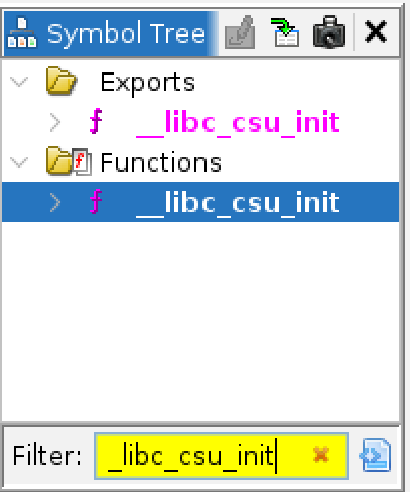
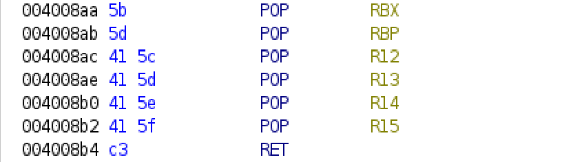
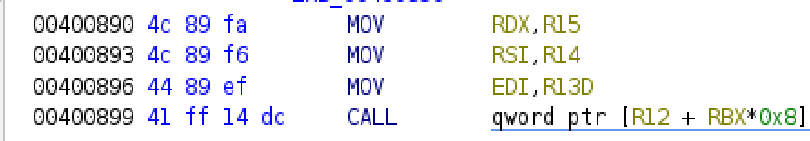

## 漏洞来源
### __libc_csu_init是传统 Linux ELF 程序启动过程中一个初始化函数，也就是说这段gadget是在程序内部的（不用查libc基址和版本）。由于这个函数特性，我们可以利用它实现任意的参数注入（实际上也就控制rdi,rsi,rdx这三个寄存器）。

## 使用方法与前提
### 前提：

1. 要知道程序的加载基址偏移
2. 自返回地址起（包括但会地址），至少能够控制溢出8个槽位（也就是0x40个字节）

### 使用：

1. 先在ghidra中索引__libc_csu_init，定位该函数的代码段。

  2 找到这两段汇编码以及对应地址（我这里是因为程序的PIN没开，所以直接就用ghidra上的地址了）。

  分别记住首地址。0x4008aa,0x400890
3 构造注入的槽位：[0x4008aa][0][1][你所调用函数的地址(write)][参数3][参数2][参数1][0x400890]

   这样就成功实现任意参数注入啦。最后会执行write(参数1，参数2，参数3)

## 原理
### 其实仔细研究上图的汇编代码就知道了，我有空会来补的...
